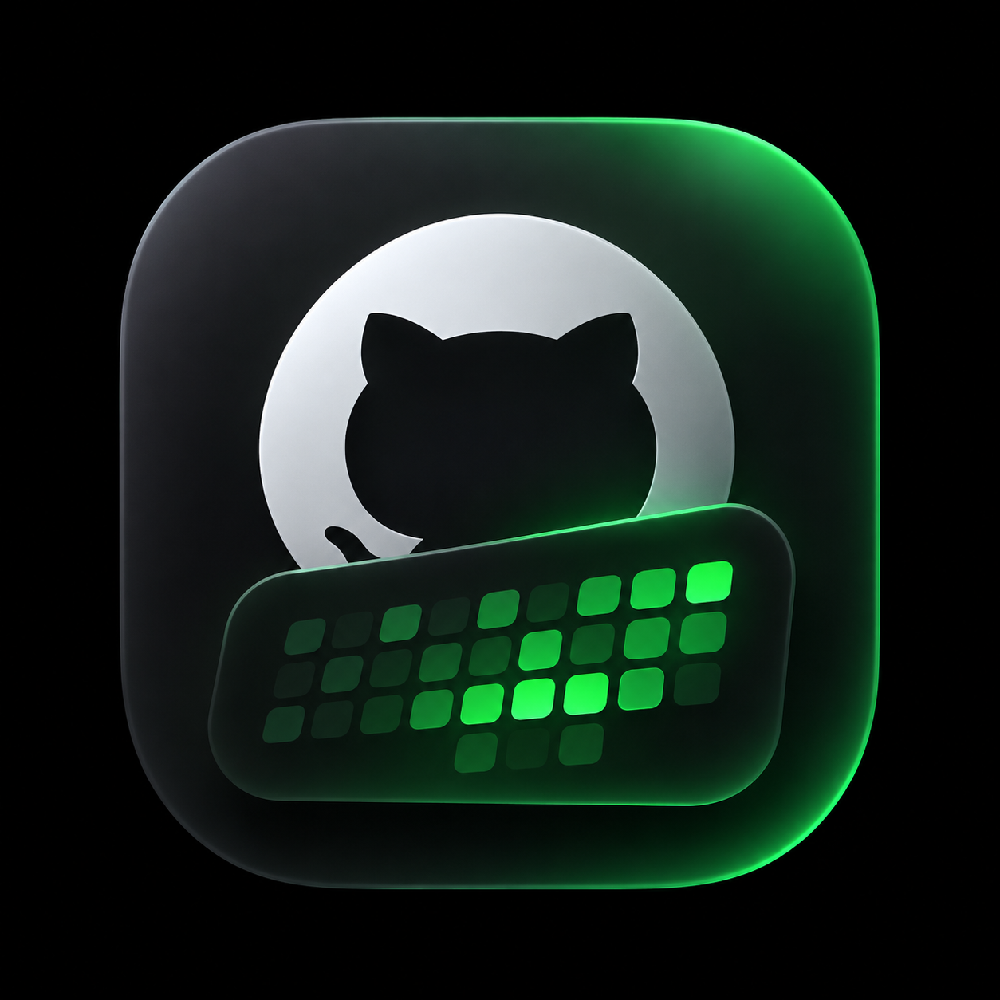
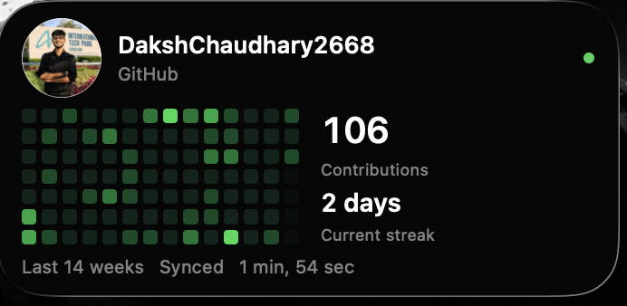

<div align="center">



# GitHub Pulse

### Your code. Your consistency. Your desktop.

**A beautiful, lightweight GitHub contribution widget for macOS.**

Built natively with SwiftUI and WidgetKit. No Electron. No tracking. Just your progress.

[](https://www.apple.com/macos/)
[](https://www.swift.org/)
[](LICENSE)
[](RELEASE_CHECKLIST.md)

<br>



<sub>Native macOS desktop widget · Actual GitHub activity · Minimal by design</sub>

<br>

**[Get Started](#get-started) · [Explore Features](#features) · [Architecture](#under-the-hood) · [Contribute](CONTRIBUTING.md)**

</div>

---

## A little progress, every day.

Your GitHub contribution graph shouldn't live behind another browser tab.

**GitHub Pulse brings your development activity directly to your desktop**, turning your contribution history into a quiet reminder of the work you're putting in.

No clutter. No distractions. Just a native widget that feels like it belongs on your Mac.

## Features

| | |
|---|---|
| **Contribution Heatmap** | 14 weeks of daily GitHub activity in a compact, GitHub-green grid |
| **Your GitHub Identity** | Actual profile avatar and configurable username |
| **Contribution Insights** | Annual contribution total and current streak |
| **Native macOS Widgets** | Medium and large WidgetKit layouts |
| **Smart Refresh** | System-managed updates with manual refresh |
| **Offline Ready** | Cached contributions remain visible without internet |
| **Secure by Design** | Credentials stored in macOS Keychain |
| **Lightweight** | No Electron, webviews, third-party runtime dependencies or analytics |

---

## Get Started

<sub>Requires macOS 14+, Xcode 16+ with Swift 6 support, and a configured Apple development team.</sub>

**01 — Clone**

```bash
git clone https://github.com/DakshChaudhary2668/GitPulse.git
cd GitPulse
```

**02 — Configure**

```bash
cp Config/Local.xcconfig.example Config/Local.xcconfig
```

Set your development team and unique bundle identifier in `Config/Local.xcconfig`.

**03 — Build**

Open `GitHubPulse.xcodeproj` in Xcode, select the **GitHubPulse** scheme and run on **My Mac**.

Both targets must use the same development team and compatible App Group/Keychain entitlements.

**04 — Connect**

Enter your GitHub username and an expiring personal access token in the settings app, then select **Save & Refresh**.

For a classic token, use `read:user` where required. Avoid granting broad repository permissions.

**05 — Add to Desktop**

Control-click your desktop → **Edit Widgets** → **GitHub Pulse** → choose Medium or Large.

That's it. Your GitHub activity, always in sight.

---

## Designed to feel native.

| Native first | Privacy first | Battery conscious |
|:---:|:---:|:---:|
| **SwiftUI + WidgetKit** | **macOS Keychain** | **System-managed refresh** |
| No browser wrappers | No analytics or telemetry | No aggressive polling |

The widget uses a charcoal interface, subtle borders, restrained typography and GitHub-green contribution cells.

It requests refresh opportunities approximately every 30 minutes, but macOS ultimately controls the update schedule. Manual refresh is available in the host app.

---

## Under the Hood

```text
                   GITHUB
               GraphQL + REST
                     |
                     v
              GitHub API Client
                     |
                     v
             Shared App Group
              Cached Snapshot
                     |
              +------+------+
              |             |
              v             v
         macOS Host      WidgetKit
          Settings       Extension
```

**SwiftUI** renders the interface. **WidgetKit** manages widget timelines. **URLSession** fetches GitHub data. **Keychain** securely stores credentials, while the **App Group** shares cached contribution data between processes.

The heatmap displays 14 Sunday-aligned weeks, while the headline count reflects GitHub's annual contribution total. Streaks allow an unfinished current day and are limited to the returned history.

Cross-process locking and account revision checks prevent outdated refreshes from restoring disconnected account data.

<details>
<summary><strong>Project structure</strong></summary>

| File | Purpose |
|---|---|
| `Sources/Core.swift` | Models, API client, contribution calculations |
| `Sources/Storage.swift` | Keychain, shared cache, account revisions |
| `Sources/Card.swift` | Widget UI |
| `Sources/App.swift` | Settings and authentication |
| `Widget/Widget.swift` | WidgetKit timeline provider |
| `Config/` | Signing configuration |
| `Tests/` | Regression tests |
| `scripts/` | Build and security checks |

</details>

<details>
<summary><strong>Security and data handling</strong></summary>

Tokens are stored in the shared macOS data-protection Keychain and sent to GitHub's GraphQL API through HTTPS Authorization headers. They are never written into the JSON cache.

The cached snapshot contains profile activity and avatar data, protected by the app sandbox but not independently encrypted.

Disconnect removes the local token and cached snapshot and requests widget reloads. It does not revoke the token on GitHub, and macOS may temporarily retain previously rendered snapshots.

No telemetry or analytics are collected. See [SECURITY.md](SECURITY.md).

</details>

<details>
<summary><strong>Build and verification</strong></summary>

```bash
scripts/test.sh
python3 scripts/audit.py

xcodebuild \
  -project GitHubPulse.xcodeproj \
  -scheme GitHubPulse \
  -configuration Release \
  -derivedDataPath /tmp/PulseBuild \
  CODE_SIGNING_ALLOWED=NO build
```

Tests are standalone Swift regression executables, not XCTest. Unsigned builds cannot verify signed Keychain/App Group behavior or installed desktop rendering.

</details>

<details>
<summary><strong>Troubleshooting</strong></summary>

- **Widget missing:** Run the signed host from a stable Applications location and reopen Edit Widgets.
- **Desktop widgets disabled:** Enable them in System Settings → Desktop & Dock.
- **Appearance tinted:** Choose Full Color widget style.
- **Signing issues:** Check both targets' development team and resolved entitlements.
- **Authentication errors:** Check token expiration, permissions, organization policies and rate limits.
- **Xcode components missing:** Complete Xcode first-launch setup using Apple's supported tooling.

</details>

---

## Project Status

> **Development Preview — Source Only**
>
> GitHub Pulse is not yet a stable v1.0.0 release. Live account-switching and installed test-widget verification remain incomplete. No signed or notarized binary is distributed.

| Milestone | Status |
|---|---|
| Native macOS application and widgets | Complete |
| GitHub contribution calendar and profile | Complete |
| Keychain and App Group integration | Locally verified |
| Offline caching and account management | Locally tested |
| Live account-switching verification | Pending |
| Installed test-widget verification | Pending |
| Hosted CI validation | Pending |
| v1.0.0 stable release | On hold |

See [Security Audit](AUDIT.md), [Release Checklist](RELEASE_CHECKLIST.md), and [Changelog](CHANGELOG.md).

---

## Contributing

GitHub Pulse is open source, and contributions are welcome.

Found a bug? Have an idea? Want to improve the macOS experience?

Read the [Contributing Guide](CONTRIBUTING.md) before submitting a pull request. For vulnerabilities, follow the [Security Policy](SECURITY.md).

## License

Distributed under the [MIT License](LICENSE).

---

<div align="center">

**Built for developers who trust the process.**

Made with SwiftUI, WidgetKit, and a little obsession with clean interfaces.

[GitHub](https://github.com/DakshChaudhary2668/GitPulse) · [Contribute](CONTRIBUTING.md) · [Report an Issue](https://github.com/DakshChaudhary2668/GitPulse/issues)

<sub>Independent project. Not affiliated with GitHub or Apple.</sub>

</div>
